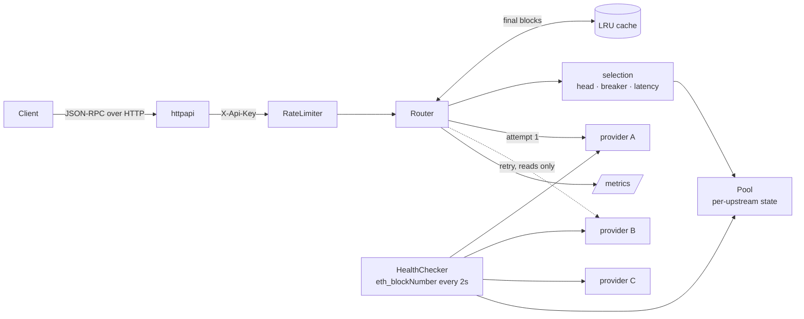

# rpcgate

[](https://github.com/Amadeus-22/rpcgate/actions/workflows/ci.yml)
[](https://github.com/Amadeus-22/rpcgate/actions/workflows/release.yml)

A JSON-RPC gateway for Ethereum, written in Go. It sits in front of several
providers, routes each request to one that can answer it correctly right now,
retries reads safely, and exposes what each provider is doing.

**Why:** providers fail in different ways (`429`, hung requests, `-32005 limit
exceeded`, nodes a few blocks behind that answer `null` for a block that exists).
Hard-coding one URL, or adding retry loops to every service, breaks during
incidents and can retry writes. Clients keep speaking plain JSON-RPC; the
gateway handles the routing.

## Features

- **Head-aware routing.** A request for block N goes only to upstreams that have
  block N; `latest`/`pending` only to upstreams at the best head. A lagging node
  still serves historical reads.
- **Safe retries.** Reads that fail with a network error, timeout, HTTP 429/5xx
  or `-32005` are retried on a *different* upstream (default 2 retries) within the
  client's deadline. Writes (`eth_sendRawTransaction`) are sent once and never
  retried; the client is told when the outcome is unknown.
- **Circuit breaker per upstream:** opens after consecutive failures; after a
  cooldown one trial call decides whether it closes.
- **Selection:** lowest EWMA probe latency (2 ms bands), then weight, with
  rotation among equals; per-upstream `max_rps` spills load to the next one.
- **Batches** are split, each item routed on its own, and reassembled by id.
- **Finality-aware LRU cache:** `eth_chainId`, and blocks, transactions and
  receipts once `finality_depth` blocks deep; never `latest`. Off by default.
- **Client rate limits** per `X-Api-Key` (token bucket), optional anonymous tier.
- **Observability:** Prometheus metrics, JSON logs, `GET /v1/upstreams`.

Out of scope for now: several chains per process, WebSocket subscriptions,
state shared between replicas.

## Quick start

Requires Docker, or Go 1.24+.

```sh
# rpcgate in front of three anvil nodes mining a block per second
docker compose -f deploy/docker-compose.yml up -d --build

curl -s localhost:8545 -H 'content-type: application/json' \
  -d '{"jsonrpc":"2.0","id":1,"method":"eth_blockNumber"}'
# {"jsonrpc":"2.0","id":1,"result":"0x6"}

curl -s localhost:8545/v1/upstreams
# {"upstreams":[{"name":"anvil-1","healthy":true,"reachable":true,"head":6,
#   "lag_blocks":0,"latency_ms":0.242,"breaker":"closed","error_rate":0}, ...]}

docker compose -f deploy/docker-compose.yml stop anvil-2   # anvil-2 turns unhealthy
docker compose -f deploy/docker-compose.yml start anvil-2
make test-integration                                      # tests against this stack
docker compose -f deploy/docker-compose.yml down
```

Without Docker (expects JSON-RPC nodes on `localhost:8546-8548`, e.g. `anvil --port 8546`):

```sh
cp .env.example .env    # points at config.example.yaml
make run
```

Prebuilt binaries (linux/darwin, amd64/arm64) are on the
[releases page](https://github.com/Amadeus-22/rpcgate/releases).

## How it works



Layers follow `domain` ← `app` ← `adapter` ← `cmd`. Routing rules (`jsonrpc`,
`selection`, `upstream`, `ratelimit`) are pure and table-tested; `app` owns
state and the retry loop; adapters do HTTP and caching. Package map and failure
modes: [docs/ARCHITECTURE.md](docs/ARCHITECTURE.md).

Design decisions (ADRs):

- [0001 Head-aware routing](docs/adr/0001-head-aware-routing.md)
- [0002 Never auto-retry writes](docs/adr/0002-never-auto-retry-writes.md)
- [0003 What is cacheable, and why](docs/adr/0003-cacheable-responses.md)
- [0004 In-process state (no Redis)](docs/adr/0004-in-process-state.md)

## Configuration

Process settings are environment variables; the upstream list is a YAML file
([config.example.yaml](config.example.yaml)). The YAML is decoded strictly (an
unknown key is an error) and validated at startup. `${NAME}` in upstream URLs and
client keys is replaced with the environment variable `NAME`, so provider API
keys stay out of the file.

| Environment variable | Default | Meaning |
|---|---|---|
| `RPCGATE_CONFIG` | `config.yaml` | path to the YAML file |
| `RPCGATE_LISTEN_ADDR` | `:8545` | HTTP listen address |
| `RPCGATE_LOG_LEVEL` | `info` | `debug`, `info`, `warn`, `error` |

| YAML key | Default | Meaning |
|---|---|---|
| `chain_id` | `0` (no check) | upstreams reporting another chain id are never used |
| `upstreams[].name` / `.url` | required | URL is `http(s)://…`, never logged or exposed |
| `upstreams[].weight` | `1` | priority within the same latency band |
| `upstreams[].max_rps` | `0` (unlimited) | requests per second sent to this upstream |
| `health.interval` / `.timeout` | `2s` / `1s` | head probe period and timeout (timeout ≤ interval) |
| `health.max_lag_blocks` | `5` | max lag for requests not tied to a block (e.g. `eth_chainId`) |
| `breaker.failure_threshold` / `.cooldown` | `5` / `10s` | failures that open the breaker; time before a trial call |
| `routing.max_retries` | `2` | extra attempts for reads, each on another upstream (0–5) |
| `routing.upstream_timeout` / `.request_timeout` | `5s` / `10s` | per attempt / whole request including retries |
| `routing.max_batch_size` / `.max_body_bytes` | `100` / `2097152` | batch items / request body limit |
| `cache.max_bytes` | `0` (off) | LRU size in bytes |
| `cache.finality_depth` | `64` | blocks below the best head considered final |
| `clients.anonymous.rps` / `.burst` | absent (key required) | shared bucket for requests without `X-Api-Key` |
| `clients.keys[].key` / `.rps` / `.burst` | — | one bucket per API key |

## API

| Endpoint | Description |
|---|---|
| `POST /` | JSON-RPC 2.0, single or batch; optional `X-Api-Key` header |
| `GET /v1/upstreams` | head, lag, latency, breaker and error rate per upstream (no URLs) |
| `GET /healthz` | process alive |
| `GET /readyz` | 200 if at least one upstream answered its last probe, else 503 |
| `GET /metrics` | Prometheus exposition |

Gateway errors keep the JSON-RPC shape, with an HTTP status that says what happened:

| Situation | HTTP | JSON-RPC error |
|---|---|---|
| upstream answered (result or its own error) | 200 | as returned by the upstream |
| no eligible upstream (down, lagging or breaker open) | 503 | `-32603` `no healthy upstream` |
| every attempt failed | 502 | `-32603` `upstream request failed` |
| write failed after it may have been sent | 502 | `-32603` `…its outcome is unknown` |
| request deadline passed | 504 | `-32603` `request deadline exceeded` |
| client over its rate limit | 429 + `Retry-After` | `-32005` `rate limit exceeded` |
| missing or unknown API key | 401 | `-32600` |
| invalid JSON / empty or oversized batch | 400 | `-32700` / `-32600` |
| body over `max_body_bytes` | 413 | `-32600` |

In a batch the HTTP status is 200 and each item carries its own error. Non-RPC
endpoints return `{"error":{"code":"snake_case","message":"..."}}`.

### Metrics

| Metric | Labels | Meaning |
|---|---|---|
| `rpcgate_requests_total` | `method`, `upstream`, `outcome` | upstream attempts; `outcome` ∈ `ok`, `rpc_error`, `limited`, `timeout`, `failure`, `canceled`, or `no_upstream` |
| `rpcgate_request_duration_seconds` | `method`, `upstream` | attempt latency histogram |
| `rpcgate_upstream_head` / `_lag_blocks` | `upstream` | head from the last probe / blocks behind the best head |
| `rpcgate_breaker_state` | `upstream` | 0 closed, 1 half-open, 2 open |
| `rpcgate_cache_hits_total` / `rpcgate_retries_total` | `method` | cache hits / retries on another upstream |

Unknown method names are collapsed to `eth_other`, `debug_other`… or `other`, so
clients cannot inflate metric cardinality.

## Testing

```sh
make check              # go vet, gofmt, go test -race ./...  (what CI runs, plus make build)
make test-integration   # adds the integration test against the compose stack
```

The router is tested against `httptest` upstreams that fail, hang, return 429 or
`-32005`, answer with the wrong id or lag behind the head
([router_chaos_test.go](internal/app/router_chaos_test.go)). Covered: retry on a
different upstream, writes never retried, head-aware routing, breaker
open → half-open → closed, batch split and reassembly by id, client deadline,
`max_rps` spill-over, cache serving only final blocks, chain id mismatch, and
all upstreams unhealthy.

## Roadmap

- Helm chart and Grafana dashboard.
- Multi-chain via route prefix.
- WebSocket subscriptions; shared cache and rate limits (Redis) across replicas.

## License

[MIT](LICENSE)
