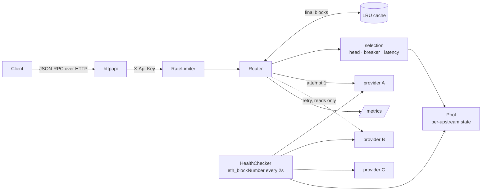

# rpcgate

A JSON-RPC gateway for Ethereum that spreads traffic across providers, routes
around unhealthy or lagging ones, and shows what each provider is doing.

## Problem

Every dapp backend, trading bot and indexer reaches Ethereum through JSON-RPC
providers, and every provider fails in its own way: `429` rate limits, requests
that hang, `-32005 limit exceeded`, nodes a few blocks behind that answer
`null` for a block that exists. Teams hard-code one provider URL and find out
during an incident. Their options are then bad: add retry loops to every
service, which retry writes and hammer the same failing provider, or swap URLs
by hand while the incident is running.

rpcgate is a drop-in JSON-RPC endpoint in front of several providers. Clients
keep speaking plain JSON-RPC; the gateway decides, per request, which provider
can answer it correctly right now.

## What it does

- **Head-aware routing.** Tracks every upstream's head. A request for block N
  only goes to upstreams that have block N; `latest` only goes to upstreams at
  the best head. A node 10 blocks behind still serves historical reads.
- **Safe retries.** Reads that fail with a network error, timeout, HTTP 429/5xx
  or `-32005` are retried on a *different* upstream, at most twice, within the
  client's deadline. Writes (`eth_sendRawTransaction`) are sent once and never
  retried: the client is told when the outcome is unknown.
- **Circuit breaker per upstream.** Consecutive failures open it; after a
  cooldown one trial call decides whether it closes.
- **Latency-aware selection.** Lowest EWMA probe latency first, weight as
  priority, rotation among equals so load spreads.
- **Batches split and reassembled.** Each item of a batch is routed on its own;
  responses come back in order, matched by id.
- **Finality-aware cache.** `eth_chainId` forever; blocks, transactions and
  receipts once they are `finality_depth` blocks deep; never `latest`.
- **Client rate limits** per `X-Api-Key` (token bucket), optional anonymous tier.
- **Observable.** Prometheus metrics per method, upstream and outcome; JSON logs;
  `GET /v1/upstreams` shows head, lag, latency, breaker and error rate.

Non-goals for the MVP: several chains per process, WebSocket subscriptions,
state shared between replicas.

## Architecture



Layering follows `domain` ← `app` ← `adapter` ← `cmd`: routing rules
(`jsonrpc`, `selection`, `upstream`, `ratelimit`) are pure and table-tested; the
`app` layer owns state and the retry loop; adapters do HTTP and caching. See
[docs/ARCHITECTURE.md](docs/ARCHITECTURE.md) for the package map and failure modes.

## Quick start

With Docker (rpcgate plus three `anvil` nodes mining a block per second):

```sh
docker compose -f deploy/docker-compose.yml up --build
curl -s localhost:8545 -H 'content-type: application/json' \
  -d '{"jsonrpc":"2.0","id":1,"method":"eth_blockNumber"}'
curl -s localhost:8545/v1/upstreams
docker compose -f deploy/docker-compose.yml stop anvil-2   # watch it drop out
make test-integration                                      # runs against this stack
```

Without Docker:

```sh
cp .env.example .env              # points at config.example.yaml
make run                          # expects upstreams on localhost:8546-8548
make check                        # vet, gofmt, go test -race ./...
```

## Configuration

Process settings are environment variables. The upstream list is a YAML file,
because it is a list of structured records; it is decoded strictly (an unknown
key is an error) and validated at startup. In upstream URLs and client keys,
`${NAME}` is replaced with the environment variable `NAME`, so provider API keys
stay out of the file. See [config.example.yaml](config.example.yaml).

| Environment variable | Default | Meaning |
|---|---|---|
| `RPCGATE_CONFIG` | `config.yaml` | path to the YAML file |
| `RPCGATE_LISTEN_ADDR` | `:8545` | HTTP listen address |
| `RPCGATE_LOG_LEVEL` | `info` | `debug`, `info`, `warn`, `error` |

| YAML key | Default | Meaning |
|---|---|---|
| `chain_id` | `0` (no check) | upstreams reporting another chain id are never used |
| `upstreams[].name` | required | label in logs, metrics and the admin API |
| `upstreams[].url` | required | `http(s)://…`; never logged or exposed |
| `upstreams[].weight` | `1` | priority among upstreams in the same latency band |
| `upstreams[].max_rps` | `0` (unlimited) | requests per second sent to this upstream |
| `health.interval` | `2s` | head probe period |
| `health.timeout` | `1s` | probe timeout (≤ interval) |
| `health.max_lag_blocks` | `5` | lag beyond which an upstream is unhealthy for tip requests |
| `breaker.failure_threshold` | `5` | consecutive failures that open the breaker |
| `breaker.cooldown` | `10s` | time open before a trial call |
| `routing.max_retries` | `2` | extra attempts for reads, each on another upstream (0–5) |
| `routing.upstream_timeout` | `5s` | per attempt |
| `routing.request_timeout` | `10s` | whole request including retries |
| `routing.max_batch_size` | `100` | items per batch |
| `routing.max_body_bytes` | `2097152` | request body limit |
| `cache.max_bytes` | `0` (off) | LRU size in bytes |
| `cache.finality_depth` | `64` | blocks below the best head considered final |
| `clients.anonymous.rps` / `.burst` | absent (key required) | shared bucket for requests without `X-Api-Key` |
| `clients.keys[].key` / `.rps` / `.burst` | — | one bucket per API key |

## API

| Endpoint | Description |
|---|---|
| `POST /` | JSON-RPC 2.0, single or batch. Optional `X-Api-Key` header. |
| `GET /v1/upstreams` | state of every upstream (no URLs) |
| `GET /healthz` | process alive |
| `GET /readyz` | 200 if at least one upstream answered its last probe, else 503 |
| `GET /metrics` | Prometheus exposition |

Gateway errors keep the JSON-RPC shape, with an HTTP status that says what happened:

| Situation | HTTP | JSON-RPC error |
|---|---|---|
| upstream answered (result or its own error) | 200 | as returned by the upstream |
| no upstream is eligible (all down, lagging or tripped) | 503 | `-32603` `no healthy upstream` |
| every attempt failed | 502 | `-32603` `upstream request failed` |
| write failed after it may have been sent | 502 | `-32603` `…its outcome is unknown` |
| request deadline passed | 504 | `-32603` `request deadline exceeded` |
| client over its rate limit | 429 + `Retry-After` | `-32005` `rate limit exceeded` |
| missing or unknown API key | 401 | `-32600` |
| invalid JSON / empty or oversized batch | 400 | `-32700` / `-32600` |
| body over `max_body_bytes` | 413 | `-32600` |

In a batch the HTTP status is 200 and each item carries its own error.
Other API errors use `{"error":{"code":"snake_case","message":"..."}}`.

```sh
$ curl -s localhost:8545/v1/upstreams
{"upstreams":[{"name":"anvil-1","healthy":true,"reachable":true,"head":4,"lag_blocks":0,
  "latency_ms":0.52,"breaker":"closed","error_rate":0}, ...]}
```

## Metrics

| Metric | Labels | Meaning |
|---|---|---|
| `rpcgate_requests_total` | `method`, `upstream`, `outcome` | upstream attempts; `outcome` ∈ `ok`, `rpc_error`, `limited`, `timeout`, `failure`, `canceled`; `upstream="none", outcome="no_upstream"` when nothing was eligible |
| `rpcgate_request_duration_seconds` | `method`, `upstream` | attempt latency histogram |
| `rpcgate_upstream_head` | `upstream` | head from the last probe |
| `rpcgate_upstream_lag_blocks` | `upstream` | blocks behind the best head |
| `rpcgate_breaker_state` | `upstream` | 0 closed, 1 half-open, 2 open |
| `rpcgate_cache_hits_total` | `method` | answers served from the cache |
| `rpcgate_retries_total` | `method` | retries on another upstream |

`method` is bounded: names rpcgate does not know become `eth_other`,
`debug_other`… or `other`, so clients cannot inflate metric cardinality. Go
runtime and process metrics are exported too.

## Testing

`make check` runs `go vet`, `gofmt` and `go test -race ./...`. The router is
tested against `httptest` upstreams that fail, hang, return 429, return
`-32005`, answer with the wrong id or lag behind head
([`internal/app/router_chaos_test.go`](internal/app/router_chaos_test.go)):
retry on a different upstream, no retry for writes, head-aware routing, breaker
open → half-open → closed, batch split and reassembly by id, client deadline
respected, all unhealthy → no upstream. `make test-integration` runs against the
compose stack.

## Design decisions

- [0001 — Head-aware routing](docs/adr/0001-head-aware-routing.md)
- [0002 — Never auto-retry writes](docs/adr/0002-never-auto-retry-writes.md)
- [0003 — What is cacheable, and why](docs/adr/0003-cacheable-responses.md)
- [0004 — In-process state (no Redis) for the MVP](docs/adr/0004-in-process-state.md)

## Roadmap

- **Phase 2:** Helm chart with HPA; Grafana dashboard; multi-chain via route prefix;
  optional one-block head tolerance for tip requests.
- **Phase 3:** WebSocket subscriptions; shared cache and rate limits (Redis) for replicas.

## License

[MIT](LICENSE)
