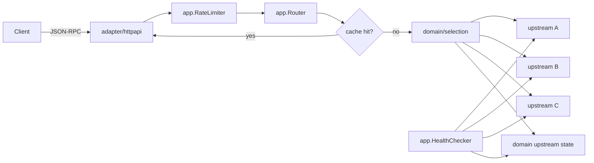

# rpcgate — Architecture

## Problem

Every dapp backend, trading bot and indexer talks to Ethereum through JSON-RPC
providers, and every provider fails in its own way: rate limits (429), timeouts,
nodes that lag behind the chain head and answer "block not found" for a block
that exists. Teams hard-code one provider and find out during an incident.
rpcgate is a drop-in JSON-RPC endpoint that spreads traffic across providers,
routes around unhealthy or lagging ones, and makes each provider's behaviour visible.

## MVP scope

- `POST /` accepts JSON-RPC 2.0 single and batch requests for one chain.
- Upstreams from a YAML file: `name`, `url`, `weight`, `max_rps`.
- **Health**: probe `eth_blockNumber` every N seconds; track each upstream's head
  and EWMA latency. Unhealthy if the probe fails or head lags the best head by more
  than `max_lag_blocks`.
- **Circuit breaker** per upstream: closed → open after consecutive failures →
  half-open after cooldown.
- **Head-aware routing**: a request that names block N (hex number in params) only
  goes to upstreams whose head ≥ N. `latest`/`pending` go to upstreams at the best head.
- **Selection**: among eligible upstreams, lowest EWMA latency, weight as tiebreak.
- **Retries**: only for read methods, only on retryable failures (network error,
  timeout, HTTP 429/5xx, JSON-RPC `-32005` limit exceeded), on a *different*
  upstream, at most 2 retries, within the client's deadline.
- **Writes**: `eth_sendRawTransaction` goes to exactly one upstream and is never
  retried automatically (see ADR 0002).
- **Cache**: `eth_chainId` forever; block/receipt lookups by explicit number or
  hash once older than `finality_depth`; never for `latest`. In-memory LRU with size cap.
- **Client rate limit**: token bucket per `X-Api-Key` (keys and limits in YAML).
- Admin API: `GET /v1/upstreams` (state, head, lag, latency, breaker, error rate).

Non-goals (MVP): multiple chains per process, websocket subscriptions, persistent cache.

## Diagram

## Package map

| Package | Responsibility |
|---|---|
| `cmd/rpcgate` | wiring, graceful shutdown; `integration_test.go` (tag `integration`) runs against the compose stack |
| `internal/domain/jsonrpc` | request/response types, batch parsing, block-param extraction (`Block`), method classification (`IsWrite`, `CacheRuleFor`, `Cacheable`), bounded metric labels |
| `internal/domain/upstream` | upstream state, EWMA, circuit breaker, failure sentinels (`ErrTimeout`, `ErrRateLimited`…); pure |
| `internal/domain/selection` | eligibility (reachability, breaker, head) and ordering (latency band → weight → rotation among equals); pure |
| `internal/domain/ratelimit` | token bucket with the clock passed in; pure (used for client keys and upstream `max_rps`) |
| `internal/app` | `Router` (cache → select → call → retry, batch split), `Pool` (per-upstream state behind a lock), `HealthChecker`, `RateLimiter`; ports `Upstream`, `Cache`, `Metrics` |
| `internal/adapter/upstreamhttp` | HTTP JSON-RPC client with per-call timeout; classifies failures; never leaks the URL |
| `internal/adapter/lrucache` | in-memory LRU bounded by bytes; implements `app.Cache` |
| `internal/adapter/httpapi` | JSON-RPC endpoint, client rate limit, admin API, health, metrics endpoint, error mapping |
| `internal/platform/config` | env (process settings) + strict YAML (topology), `${VAR}` expansion, defaults, validation |
| `internal/platform/logging` | JSON `slog` logger |
| `internal/platform/metrics` | Prometheus registry; implements `app.Metrics` |

## Failure modes

| Failure | Behaviour |
|---|---|
| All upstreams unhealthy | JSON-RPC error `-32603` "no healthy upstream", HTTP 503, metric increments |
| Upstream returns 429 | breaker failure counted, request retried elsewhere if read |
| Upstream lags | excluded for requests above its head; still used for older blocks |
| Client deadline shorter than retries | stop retrying when context expires |
| Batch with mixed methods | split: each item routed independently, responses reassembled by `id` |
| Upstream serves another chain | `chain_id` check on first probe; the upstream stays unreachable |
| Write fails after it may have been sent | not retried; `-32603` saying the outcome is unknown, HTTP 502 |
| Client over its key's rate | `-32005`, HTTP 429 with `Retry-After`; a batch costs one token per item |

## Metrics

`rpcgate_requests_total{method,upstream,outcome}`, `rpcgate_request_duration_seconds{method,upstream}`,
`rpcgate_upstream_head{upstream}`, `rpcgate_upstream_lag_blocks{upstream}`,
`rpcgate_breaker_state{upstream}`, `rpcgate_cache_hits_total{method}`, `rpcgate_retries_total{method}`.
`method` is bounded: unknown method names collapse to `eth_other`, `debug_other`… or `other`.

## Local test bed

`docker compose` runs three `anvil` nodes as upstreams. Chaos tests in Go use
`httptest` upstreams that can be told to fail, lag, return 429 or hang.

## ADRs to write

0001 head-aware routing · 0002 never auto-retry writes · 0003 what is cacheable and why ·
0004 in-process state (no Redis) for the MVP.

## Roadmap

Phase 2: Helm chart with HPA; Grafana dashboard; multi-chain via route prefix.
Phase 3: WebSocket subscriptions; shared cache (Redis) for replicas.
